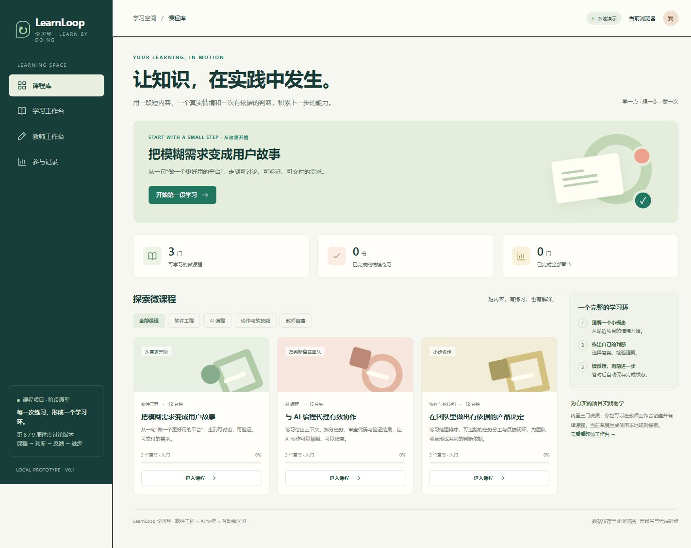

# LearnLoop 学习环

面向软件开发与工程学习的互动微课程平台。当前版本为**第8–9周进度讨论原型**，用于展示学习、测验、教师备课与参与记录的完整流程。

仓库：[Cobblepot2/GenAI-powered-learning-platform](https://github.com/Cobblepot2/GenAI-powered-learning-platform)。



## 快速运行

需要 Python 3.10 或更新版本；原型不需要安装第三方库、前端依赖或配置模型密钥。

```sh
python serve.py
```

浏览器打开 <http://127.0.0.1:5241>。若端口已被占用，可使用 `python serve.py --port 5242`。请通过 HTTP 服务运行，不要直接双击 HTML。

## 可以演示什么

- 三门实际可学习的微课：需求与用户故事、AI 编程代理、团队协作与产品思维。
- 阅读短课、回答情境题、查看逐项反馈，保存学习进度并在刷新后恢复。
- 教师按主题、学习者背景和目标生成规则模板草稿，手动编辑、审核并发布到课程库。
- 参与记录来自当前浏览器产生的真实操作；无预填的虚构学生和访谈数据。

**当前生成器是本地规则模板，未调用真实生成式 AI。** 学习者和教师仅为演示视图，没有账户或访问权限系统。课程、进度和活动保存在当前浏览器的 `localStorage`；清除浏览器数据会丢失记录，不支持跨设备同步。真实 AI、账号、学生导入和班级统计属于下一阶段工作。

## 第8–9周讨论材料

- [两页进度摘要 PDF](output/pdf/learnloop-week8-9-progress.pdf)
- [约6分钟讨论与演示提纲](docs/meeting-script.md)
- [项目范围、需求映射与验收条件](docs/project-plan.md)
- [系统架构、数据模型与 AI 能力边界](docs/architecture.md)
- [用户验证脚本与空白记录表](docs/user-validation.md)
- [后续任务和教学周路线](docs/backlog-and-roadmap.md)
- [可供整理为 GitHub issues 的任务 CSV](docs/backlog.csv)
- [实际验证记录](docs/verification.md)

建议演示顺序：课程库 → 完成一节微课与测验 → 查看进度 → 教师生成并编辑草稿 → 审核发布 → 返回课程库 → 查看参与记录。提纲不安排成员分工展示；分工和个人贡献仍待团队自行确认。

当前材料由 AI 辅助搭建。用户访谈尚未执行；验证方案与示例假设不能当作真实调研结论。提交前应自行理解、核对并调整讲述内容。

## 验证与维护

Node.js 18 或更新版本可运行纯逻辑测试：

```sh
npm test
```

两页摘要的可编辑源文件为 [`scripts/build_progress_pdf.py`](scripts/build_progress_pdf.py)。如需重新生成：

```sh
python -m pip install -r requirements-docs.txt
python scripts/build_progress_pdf.py
```

Windows 会自动尝试系统中文字体；其他系统请通过 `LEARNLOOP_CJK_FONT` 指定中文 TrueType 字体路径。此依赖仅用于重新生成 PDF，不影响原型运行。

## 目录

```text
web/                 静态原型与课程逻辑
tests/               关键业务行为测试
docs/                项目设计、讨论提纲、验证计划与任务
output/pdf/          两页讨论摘要
scripts/             可重复生成材料的脚本
serve.py             仅绑定本机的预览服务器
```

下一阶段优先验证学习与教师操作，再接入服务端模型、数据库和账户权限，并准备第11周的公开部署、视频、报告与幻灯片。
