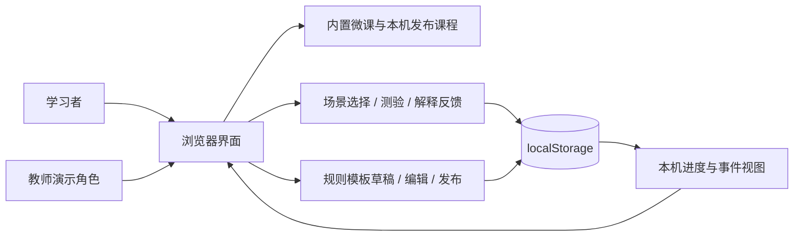
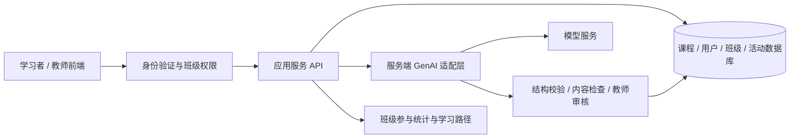

# LearnLoop 系统设计

## 当前原型

当前版本采用纯 HTML、CSS、JavaScript 和浏览器 `localStorage`。它用于验证学习流程与教师操作方式。课程、学习进度和事件均限于当前设备与当前浏览器；不同浏览器之间不共享数据。

“学习者”和“教师”是演示视图，不是经过身份验证的账号或权限。公开部署静态页面也不会自动增加多人协作、云存储或服务端 AI 能力。

## 计划中的正式系统

以下部分尚未实现，需在用户验证和教师意见明确后安排。

教师提交生成请求后，服务端校验输入、调用模型、验证结果结构，再让教师编辑并审核后发布。模型凭证保留在服务端；生成失败应返回清楚的错误并允许保留人工草稿。

## 逻辑数据模型

此处描述数据含义，具体字段名以源代码为准。

| 实体 | 关键内容 | 当前存放位置 / 限制 |
|---|---|---|
| Course | 标识、标题、主题、简介、活动列表、发布状态 | 内置内容与本机存储；没有服务器版本管理 |
| Activity | 场景、选项、正确答案或评价规则、解释 | 随课程保存；当前以选择和测验为主 |
| Progress | 课程标识、已完成活动、回答、完成状态 | 当前浏览器；不是经过验证的个人学习档案 |
| LearningEvent | 事件类型、课程或活动标识、发生时间 | 当前浏览器；不足以代表全班参与情况 |
| Draft | 教师输入、模板生成内容、编辑结果 | 本机；需人工审核课程质量 |
| User / Class / Enrollment | 身份、角色、班级、选课关系 | 计划新增，当前没有正式账号或班级数据 |

主要流程：选择课程 → 阅读场景 → 提交选择 → 查看反馈 → 保存进度和事件。教师流程：输入主题 → 生成模板草稿 → 编辑内容 → 本机发布 → 进入学习页检验。

## AI 能力边界

当前“生成”使用预设规则和模板，不调用大语言模型，也不保证对任意主题生成正确、深入的内容。界面和演示必须明确这一点。开发时使用 AI 编写代码，与平台运行时提供 GenAI 是两件分别需要说明的事实。

正式 AI 功能的最低设计约束：

- 返回可校验的课程结构；缺少必填字段或测验答案时不得直接发布。
- 教师检查事实、学习目标、题目与答案一致性，编辑后确认发布。
- 记录模型配置、生成版本和审核决定；敏感数据与凭证不进入公开仓库。
- 用一组固定主题比较结构有效性、内容准确性和生成耗时，再决定是否达到验收要求。

## 关键风险与处理

| 风险 | 本阶段处理 | 后续处理 |
|---|---|---|
| 清理浏览器会丢失进度 | 演示前检查本机状态，明确存储范围 | 数据库与必要的导出 / 备份机制 |
| 模板被误认成真实 AI | 持续展示“规则模板”标签并口头说明 | 接入模型后提供实际生成证据 |
| 演示角色被误认成权限系统 | 不放入真实学生个人资料 | 服务端鉴权、班级权限和数据隔离 |
| 题目质量不足 | 教师视图支持编辑，准备内容审查清单 | 用户验证与教师审核；保留修订记录 |
| 工作量超出时间 | 保留三门微课与完整单次学习闭环 | 先完成课程生成、账号和部署，再扩展功能 |
